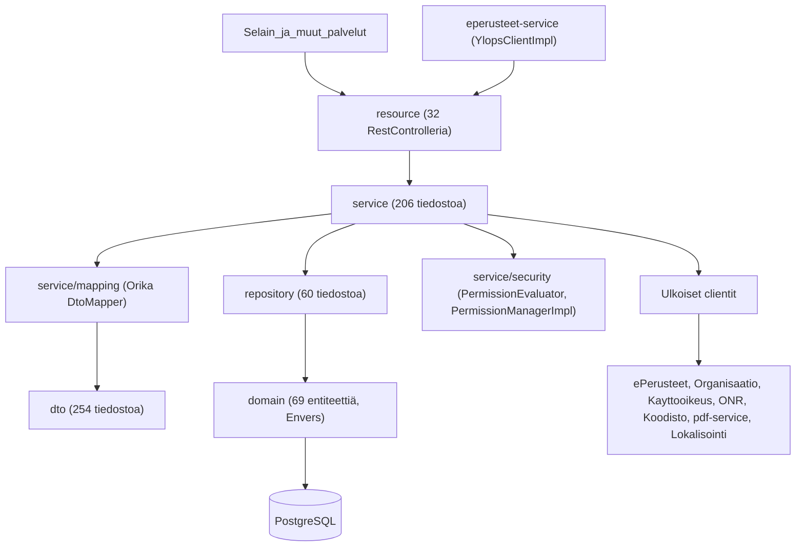
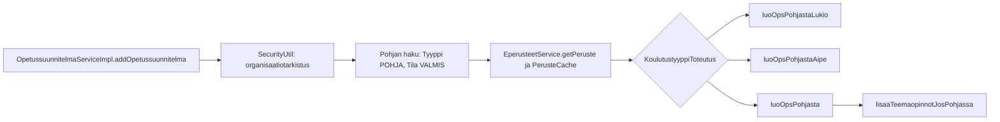
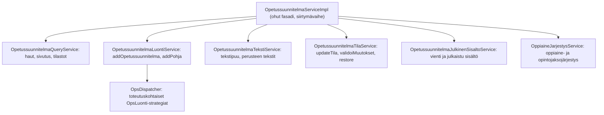

# eperusteet-ylops-service - parannussuunnitelma

| Tieto | Arvo |
|---|---|
| Dokumentin luontipäivä | 22.10.2026 |
| Laatija | Cursor-agentti |
| Käytetty malli | Claude Opus 5.5 |
| Laajuus | `eperusteet-ylops-service` (Spring Boot 4.1.1, Java 21, moduulin versio 3.0.0) |
| Koko | 692 Java-tiedostoa / noin 41 000 riviä (main), 44 tiedostoa / noin 7 500 riviä (test) |

Luvut perustuvat staattiseen koodianalyysiin (`wc -l`, hakulausekkeet, `mvn -o dependency:list`, käsin luetut luokat). Ne ovat suuntaa-antavia ja kannattaa tarkistaa ennen kunkin työn aloittamista.

---

## 1. Yhteenveto

Sovelluksen teknologinen pohja on ajantasainen: Spring Boot 4.1.1, Spring Framework 7, Hibernate 7.4, Flyway 12, springdoc 3 ja jakarta-nimiavaruus. Pohja on sama kuin `eperusteet-service`-palvelussa, koska molemmat perivät kaiken parent-pomista `eperusteet-parent-pom:4.1.1-11`. Tekninen velka johtuu seuraavista asioista:

1. **Suuret service-luokat (god class).** `OpetussuunnitelmaServiceImpl` on 2311 riviä, ja siinä on 56 julkista metodia ja 32 kenttäinjektoitua riippuvuutta. `OppiaineServiceImpl` on 1487 riviä. Service-kerroksessa on noin puolet main-koodin riveistä. `OpetussuunnitelmaServiceImpl` ja `JulkaisuServiceImpl` riippuvat toisistaan syklisesti `@Lazy`-injektion kautta, ja sovellus vaatii asetuksen `spring.main.allow-circular-references=true`.
2. **Oikeustarkistusten ja testien aukot.** HTTP-tasolla kaikki `GET /api/**` -pyynnöt sallitaan, joten lukuoikeudet ovat pelkästään metoditason `@PreAuthorize`-annotaatioiden varassa. Testeissä käytetään `TestPermissionEvaluator`ia, joka hyväksyy jokaisen kirjautuneen käyttäjän, joten oikeaa oikeuslogiikkaa ei testata lainkaan. Koodissa on lisäksi TODO-merkittyjä puuttuvia lukuoikeustarkistuksia ja yksi ilmeinen virhe (`VuosiluokkakokonaisuusServiceImpl.add`).
3. **Testit.** Kaikki 29 JUnit-testejä käyttävää tiedostoa käyttävät JUnit 4:ää ja XML-pohjaista Spring-kontekstia. Oletusintegraatiotestit ajetaan H2:lla ilman Flywayta, joten 172 SQL-migraatiota testataan vain yhdessä Testcontainers-testiluokassa.
4. **Riippuvuuksien hajanaisuus.** Kuusi OPH:n SNAPSHOT-kirjastoa, Orika 1.5.4, rinnakkain Jackson 2 ja 3, HttpClient 4, commons-collections 3, Joda-Time sekä testikirjastoja compile-scopessa. Useimmat riippuvuuskorjaukset koskevat parent-pomia ja siten myös muita eperusteet-palveluita.

Suurin hyöty saadaan pilkkomalla `OpetussuunnitelmaServiceImpl` ja purkamalla opetussuunnitelman ja julkaisun välinen sykli. Pienimmällä työllä saadaan pikavoittoja: korjataan oikeustarkistusten TODO-kohdat ja `findOne(opsId)`-virhe, korjataan riippuvuuksien scopet ja korjataan hiljaiset `catch`-lohkot.

---

## 2. Arkkitehtuuri

### 2.1 Kerrokset

| Paketti | Tiedostoja | Rivejä (noin) | Rooli |
|---|---:|---:|---|
| `service` | 206 | 20 400 | Liiketoimintalogiikka, validointi, mappaus, oikeudet, integraatiot, ajastukset |
| `dto` | 254 | 6 100 | API- ja siirto-oliot, mukana 60 ePerusteiden DTO-kopiota (`dto/peruste`) |
| `domain` | 110 | 7 500 | JPA-entiteetit, Envers-auditointi (`@Audited` 137 kertaa 53 tiedostossa) |
| `resource` | 49 | 4 300 | REST-rajapinnat (springdoc) ja virheenkäsittely |
| `repository` | 60 | 1 700 | Spring Data JPA, Criteria API, natiivi-SQL (16 `nativeQuery`-kyselyä 8 tiedostossa) |
| `config` | 12 | 900 | Tietoturva, async, ajastukset, Flyway, sessio, Swagger |
| `security` | 0 | 0 | Tyhjä paketti |

Service-kerroksen suurimmat alipaketit ovat `service/ops` (71 tiedostoa, noin 10 800 riviä), `service/external` (35 tiedostoa, noin 2 300 riviä), `service/util` (30 tiedostoa, noin 1 900 riviä) ja `service/lops2019` (8 tiedostoa, noin 1 300 riviä).

### 2.2 Poikkileikkaavat ratkaisut

- **Tietoturva:** CAS (`spring-security-cas`, OPH:n `opintopolku-cas-servlet-filter` ja `eperusteet-backend-utils`-kirjaston `OpintopolkuCasAuthenticationFilter`), `WebSecurityConfiguration` ja kehitysversio `WebSecurityConfigurationDev`. CSRF on poistettu käytöstä, ja `GET /api/**` on sallittu kaikille URL-tasolla. Metoditason oikeudet hoidetaan `@EnableMethodSecurity`-annotaatiolla, `PermissionEvaluator`-luokalla ja `PermissionManagerImpl`/`AbstractPermissionManager`-luokilla (yhteensä 264 riviä). `@PreAuthorize` esiintyy 378 kertaa 46 tiedostossa, pääosin service-rajapinnoissa. Sessiot tallennetaan Spring Session JDBC:llä.
- **Välimuisti:** Spring Cache ja Ehcache 3 (JCache, `jcache.xml`, 12 välimuistia) sekä Hibernaten toisen tason välimuisti (`eperusteet-hibernate-ehcache.xml`). Metoditasolla on 12 `@Cacheable`-annotaatiota, mutta ei yhtään `@CacheEvict`-annotaatiota. Välimuistit tyhjennetään ohjelmallisesti (`MaintenanceService.clearOpetussuunnitelmaCaches`).
- **Ajastukset:** `ScheduledConfiguration` siivoaa CAS-sessiot tunneittain ja korjaa jumiin jääneet PDF-tulosteet tunneittain (`fixStuckPrintings`). `ScheduledTask`-beanien ajo (`tasks()`) on kommentoitu pois merkinnällä "ToBe decided", joten `OpetussuunnitelmaCacheTask` ei käytännössä ole käytössä.
- **Async:** `AsyncConfig` (`julkaisuTaskExecutor`, oletusasetuksilla) ja `DokumenttiAsyncConfig` (`docTaskExecutor`, 1 säie, jono 100). Tietoturvakonteksti välitetään `DelegatingSecurityContextAsyncTaskExecutor`illa. Koodissa on 5 `@Async`-metodia, joista 4 ei nimeä executoria.
- **Ulkoiset integraatiot:** `EperusteetServiceImpl` (ePerusteet, `RestTemplate` ja `OphHttpClient`, perusteet tallennetaan `PerusteCache`-tauluun), `OrganisaatioServiceImpl` (organisaatio- ja käyttöoikeuspalvelu), `KayttajaClientImpl` ja `KayttajanTietoServiceImpl` (ONR), `KoodistoServiceImpl`, `ExternalPdfServiceImpl` (pdf-service) ja `LokalisointiServiceImpl` (`RestTemplate`). `RestTemplate` on käytössä 3 tiedostossa ja `OphHttpClient` 5 tiedostossa.
- **Integraatio eperusteet-serviceen:** ylops lukee ePerusteista perusteita, tiedotteita, kuvia ja termistöä (`/api/perusteet`, `/api/tiedotteet`). Vastaavat DTO:t on kopioitu käsin (`dto/peruste` 60 tiedostoa ja `service/external/impl/perustedto` 23 tiedostoa). Toiseen suuntaan eperusteet-servicen `YlopsClientImpl` kutsuu ylopsin rajapintoja `/api/opetussuunnitelmat/tilastot`, `/api/opetussuunnitelmat/julkiset/kaikki` ja `/api/peruste/arkistoitu/...`.
- **Tietokantamigraatiot:** Flywayssa on 172 SQL-migraatiota (`src/main/resources/db/migration`) eikä yhtään Java-migraatiota. Asetukset ovat `outOfOrder(true)` ja historiataulu `schema_version`. Nimeämiskäytäntöjä on kaksi: 87 juoksevasti numeroitua (`V1_0` ... `V1_87`) ja 85 aikaleimalla nimettyä (`V1_2026...`).
- **CI:** `.github/workflows/build.yml` rakentaa käyttöliittymän, ajaa `mvn clean verify -Pit` ja rakentaa kontin `ci-tools`-työkaluilla. Code Climate -kattavuusraportointi on kommentoitu pois. Repositoriossa ei ole omaa Dockerfilea eikä riippuvuuksien päivitysseurantaa (Dependabot tai Renovate).

### 2.3 Havainnot

- Kerrosjako on selkeä, mutta service-kerros on paisunut: siinä on noin 50 % main-koodin riveistä.
- `spring.main.allow-circular-references=true` (`application.properties` rivi 6) piilottaa riippuvuussyklejä, ja `spring.main.allow-bean-definition-overriding=true` (rivi 5) sallii beanien hiljaisen korvaamisen.
- `spring.mvc.pathmatch.matching-strategy=ant-path-matcher` (rivi 19) on vanhentuva asetus. Kommentin mukaan se lisättiin Springfox 3.0.0:n takia, mutta Springfox on jo vaihdettu springdociin.
- `EperusteetLocalService` (`@Profile({"test", "docker"})`) ja sen käyttämä 1,3 Mt:n `fakedata`-hakemisto ovat main-lähdepuussa, joten testidata päätyy tuotanto-JARiin.
- Moduulin oma `pom.xml` ei määrittele yhtään riippuvuutta. Kaikki riippuvuudet tulevat ulkoisesta `eperusteet-parent-pom:4.1.1-11`-pomista, joten riippuvuuskorjaukset tehdään parent-pomiin.

---

## 3. Sovelluslogiikka

### 3.1 Opetussuunnitelman luonti pohjasta

- `addOpetussuunnitelma` on 93 riviä. Se sisältää oikeustarkistuksen, pohjan valinnan, perusteen haun ePerusteista ja koulutustyyppikohtaisen haarautumisen if/else-ketjuna.
- Pohjien luonti (`addPohja` ja `addPohjaPerusopetus`, `addPohjaLukiokoulutus`, `addPohjaAipe`, `addPohjaLops2019`, `addPohjaLisaJaEsiopetus`) ja lukion vanhan rakenteen tuonti (`importLukioRakenne`, `importOppiaineet`, `importKurssit`) ovat samassa luokassa. Luonti- ja tuontikoodia on noin 660 riviä (rivit 1098-1760).

### 3.2 Koulutustyyppikohtainen strategia

- `OpsDispatcher` valitsee oikean `OpsToteutus`-beanin `KoulutustyyppiToteutus`-arvon perusteella (YKSINKERTAINEN, PERUSOPETUS, TPO, LOPS, LOPS2019, AIPE). Tätä käytetään navigaatiossa (`NavigationBuilder*` ja `NavigationBuilder*Public`), viennissä (`OpsExport*`) ja pohjan synkronoinnissa (`OpsPohjaSynkronointi*`). Malli on hyvä.
- Opetussuunnitelman luonti ja validointi haarautuvat kuitenkin edelleen if-ketjuilla. `OpetussuunnitelmaServiceImpl`issä on 28 viittausta koulutustyyppiin tai toteutukseen, joista 15 on if-ehdoissa. `ValidointiServiceImpl` haarautuu samalla tavalla (`validoiLukio2019` 80 riviä).

### 3.3 Validointi

- `ValidointiServiceImpl` (619 riviä) validoi opetussuunnitelman ennen julkaisua: julkaisukielet, perustiedot, tekstihierarkian, paikalliset opintojaksot sekä perusopetuksen oppiaineet ja LOPS2019-rakenteen.
- Kaikki säännöt ovat yhdessä luokassa yksityisinä metodeina. Yksittäisiä sääntöjä ei voi testata erikseen, eikä uuden koulutustyypin sääntöjä voi lisätä koskematta luokkaan.
- Controllereissa ei ole yhtään `@Valid`-annotaatiota. Bean Validation -rajoitteita on vain 8 DTO-tiedostossa, ja HTML-sisältö validoidaan entiteettitasolla (`@ValidHtml` 70 kertaa).

### 3.4 Tilakone

- `Tila`-enum määrittää sallitut siirtymät metodilla `mahdollisetSiirtymat(isPohja)` (LUONNOS, VALMIS, POISTETTU, JULKAISTU).
- `OpetussuunnitelmaServiceImpl.updateTila` ohittaa virheellisen siirtymän hiljaa: jos siirtymä ei ole sallittu, tila jää ennalleen, mutta metodi tyhjentää silti välimuistit, tallentaa muokkaustiedon ja palauttaa onnistuneen vastauksen.
- Siirtymällä POISTETTU -> LUONNOS on piilotettu sivuvaikutus: kaikki opetussuunnitelman julkaisut ja niiden dokumentit poistetaan.
- Rinnalla on erilliset tilat `JulkaisuTila` (`JulkaistuOpetussuunnitelmaTila`) ja `DokumenttiTila`.

### 3.5 Julkaisuvirta

- `JulkaisuServiceImpl` sisältää validoinnin, JSON-snapshotin, PDF-orkestroinnin, tilamuutokset ja välimuistin käsittelyn. `addJulkaisuAsync` on 59 riviä.
- Luokkatason `@Transactional` koskee myös async-metodia, joten validointi, snapshot ja PDF-pyynnöt ajetaan yhdessä pitkässä transaktiossa.
- `JulkaisuServiceImpl` ja `OpetussuunnitelmaServiceImpl` injektoivat toisensa `@Lazy`-annotaatiolla. `JulkaisuServiceImpl` injektoi lisäksi itsensä (`self`) async-proxyn takia ja `DokumenttiService`n `@Lazy`-viittauksena.
- `JulkaisuServiceImpl` on `@Profile("!test")`. H2-testeissä käytetään `JulkaisuServiceMock`ia, joten oikeaa julkaisulogiikkaa testaa vain `JulkaisuServiceDockerIT` (4 testiä).

### 3.6 PDF-putki

`DokumenttiServiceImpl.generateWithDto` kutsuu `ExternalPdfServiceImpl`iä, joka lähettää opetussuunnitelman viennin HTTP POST -pyynnöllä pdf-servicen osoitteeseen `/api/pdf/generate/ylops/{id}/{kieli}`. Takaisinkutsu kulkee `@Lazy DokumenttiService` -viittauksen kautta. `ExternalPdfServiceImpl` käyttää HttpClient 4:n `ContentType`-luokkaa, joka on ainoa suora HttpClient 4 -viittaus koodissa. PDF:n generointi on hyvin eriytetty omaan palveluunsa, mutta sen orkestrointi on upotettu julkaisuun.

### 3.7 Lukitus

Muokkauslukitukset hoidetaan `service/locking`-paketissa (`AbstractLockService`, `LockManagerImpl`, 5 tiedostoa). `OppiaineServiceImpl` perii `AbstractLockService`n, mikä sitoo lukituslogiikan ja oppiaineiden liiketoimintalogiikan samaan luokkahierarkiaan. `TekstiKappaleViiteServiceImpl`issä lukitus ohitetaan TODO-merkinnällä (`false /* TODO: pakota lukitus */`, rivi 220).

---

## 4. Servicet

### 4.1 Suurimmat luokat

| Luokka | Rivejä | Julkisia metodeja | `@Autowired` | Huomiot |
|---|---:|---:|---:|---|
| `service/ops/impl/OpetussuunnitelmaServiceImpl` | 2311 | ~56 | 32 | Pisimmät metodit `addOpetussuunnitelma` (93 riviä) ja `validoiMuutokset` (77 riviä). Kolme `@Lazy`-injektiota (`JulkaisuService`, `AIPEService` ja `self`). Koulutustyypin mukaan haarautuvia if-ehtoja 15. `catch (Exception)` rivillä 505 heittää `NotExistsException("")`, jolloin alkuperäinen syy katoaa. |
| `service/ops/impl/OppiaineServiceImpl` | 1487 | ~33 | 16 | Pisimmät metodit `addValinnainen` (80 riviä), `updateYksinkertainen` (79 riviä) ja `mergePerusteTavoitteet` (65 riviä). Perii `AbstractLockService`n. |
| `service/aipe/impl/AIPEServiceImpl` | 854 | ~15 | 6 | Luokkatason `@Transactional`. Hierarkia-CRUD, joka on päällekkäinen Oppiaine- ja Vuosiluokkakokonaisuus-palvelujen kanssa. |
| `service/ops/impl/LukioOpetussuunnitelmaServiceImpl` | 696 | ~20 | 11 | Vanhan lukion (LOPS) palvelu. `getOppiaineTiedot` 65 riviä. Ei yhtään testiä. |
| `service/ops/impl/ValidointiServiceImpl` | 619 | ~4 | 10 | `validoiLukio2019` 80 riviä. Kaikki validointisäännöt yhdessä luokassa. |
| `service/ops/impl/TekstiKappaleViiteServiceImpl` | 543 | ~20 | 12 | `@Lazy self`. Kolme TODO-merkintää puuttuvasta lukuoikeustarkistuksesta tai lukituksesta (rivit 191, 220 ja 321). |
| `service/external/impl/OrganisaatioServiceImpl` | 439 | ~12 | 4 | Sisäkkäiset client-luokat ja välimuistit. `printStackTrace` rivillä 169. |
| `service/external/impl/EperusteetServiceImpl` | 437 | ~18 | 6 | Tyhjä `catch` rivillä 187. Rivillä 251 `Throwables.getStackTraceAsString(e)` lasketaan, mutta tulosta ei käytetä, joten alkuperäinen virhe katoaa. HTTP-kutsut ja `PerusteCache`-logiikka samassa luokassa. |
| `service/lops2019/impl/Lops2019OpintojaksoServiceImpl` | 435 | ~18 | 14 | `addOpintojakso` 84 riviä. Luokkatason `@Transactional`. |
| `service/util/impl/JulkaisuServiceImpl` | 327 | ~9 | 16 | Kolme `@Lazy`-injektiota (`OpetussuunnitelmaService`, `DokumenttiService` ja `self`), luokkatason `@Transactional`, `@Profile("!test")`. `addJulkaisuAsync` 59 riviä. |
| `service/lops2019/impl/Lops2019OppiaineServiceImpl` | 294 | ~15 | 13 | Luokkatason `@Transactional`. |
| `service/util/impl/MemoryStatisticsServiceImpl` | 247 | - | - | 8 `catch (Exception)` -lohkoa, joista osa nielee virheen kommentilla. |
| `service/external/impl/EperusteetLocalService` | 243 | ~19 | 3 | Testiprofiilin toteutus main-koodissa. `FIXME pilko service kahteen osaan`, `printStackTrace` rivillä 159. |

### 4.2 Yleiset havainnot

- **Injektio:** `@Autowired` esiintyy 404 kertaa 111 main-tiedostossa, joista 340 kertaa 73 service-tiedostossa. Konstruktori-injektiota (`@RequiredArgsConstructor`) ei käytetä yhdessäkään tiedostossa.
- **Syklit:** koodissa on 12 `@Lazy`-injektiota 6 tiedostossa: opetussuunnitelma ja julkaisu, kolme self-injektiota (`OpetussuunnitelmaServiceImpl`, `JulkaisuServiceImpl`, `TekstiKappaleViiteServiceImpl`), PDF-takaisinkutsu (`ExternalPdfServiceImpl`), `KayttajanTietoServiceImpl` (kolme viittausta) ja `MaintenanceServiceImpl`.
- **Transaktiot:** `@Transactional` esiintyy 164 kertaa 57 tiedostossa, ja noin 45 luokassa se on luokkatasolla. `readOnly = true` esiintyy 67 kertaa. `KommenttiServiceImpl.addName` on private-metodi, jolla on `@Transactional`. Annotaatio ei vaikuta, koska Spring AOP ei sieppaa luokan sisäisiä kutsuja.
- **Poikkeukset:** `catch (Exception` esiintyy 20 kertaa 11 tiedostossa, ja `printStackTrace` 5 kertaa 4 tiedostossa (`JsonBType`, `MaintenanceServiceImpl`, `EperusteetLocalService`, `OrganisaatioServiceImpl`). `Kommentti2019ServiceImpl` (rivi 196) palauttaa virhetilanteessa käyttäjän OID:n ilman lokitusta.
- **Merkinnät:** TODO 12 kpl, FIXME 2 kpl, `@Deprecated` 26 kpl (10 tiedostossa, joista 10 kpl `UlkopuolisetController`issa), `System.out` 0 kpl. `KayttajanTietoServiceImpl`issä on kaksi rajapinnan metodia, jotka heittävät `NotImplementedException`in.
- **Oikeudet ja virheet:** `VuosiluokkakokonaisuusServiceImpl.add` (rivi 59) hakee vuosiluokkakokonaisuuden opetussuunnitelman tunnisteella (`kokonaisuudet.findOne(opsId)`), vaikka sen pitäisi käyttää DTO:n tunnistetta, ja rivillä 61 on TODO puuttuvasta lukuoikeustarkistuksesta. `LiiteServiceImpl.get` (rivi 127) ei tarkista, kuuluuko liite pyydettyyn opetussuunnitelmaan, joten oikeus yhteen opetussuunnitelmaan riittää minkä tahansa liitteen metatietojen lukemiseen, jos sen UUID tunnetaan.
- **Päällekkäisyys:** AIPE-, Oppiaine- ja Vuosiluokkakokonaisuus-palveluissa on samankaltaista hierarkian CRUD- ja järjestyslogiikkaa. Navigaatiossa on rinnakkaiset `NavigationBuilder`- ja `NavigationBuilderPublic`-toteutukset kullekin toteutukselle (esim. LOPS2019: 280 ja 286 riviä).

### 4.3 Ehdotettu `OpetussuunnitelmaServiceImpl`-luokan pilkkominen

Luokan nykyinen sisältö jakautuu luontevasti näihin osiin: hakuja ja tilastoja on noin 510 riviä (rivit 317-830), luontia ja tuontia noin 660 riviä (rivit 1098-1760), tila- ja muutosvalidointia noin 130 riviä (rivit 1968-2097) ja julkaistun sisällön vientiä noin 70 riviä (rivit 2208-2275). Rajapinta `OpetussuunnitelmaService` voidaan säilyttää siirtymävaiheen ajan, jolloin kutsujat eivät muutu ja `@PreAuthorize`-annotaatiot pysyvät rajapinnassa. Toteutus delegoi uusille luokille, ja kutsujat siirretään vähitellen käyttämään niitä suoraan. Kun `OpetussuunnitelmaJulkinenSisaltoService` on erotettu, `JulkaisuServiceImpl` voi riippua siitä eikä koko `OpetussuunnitelmaService`stä, jolloin sykli purkautuu.

---

## 5. Testit

| Mittari | Arvo |
|---|---|
| Testitiedostoja | 44, joista 26 sisältää `@Test`-metodeja |
| `@Test`-metodeja | 140, joista 124 IT-testeissä |
| `@ParameterizedTest` | 0 |
| JUnit 4 | 29 tiedostoa (JUnit 4 -importit), `SpringJUnit4ClassRunner` 3 pohjaluokassa |
| JUnit 5 | 0 tiedostoa |
| Kirjastot | AssertJ (21 tiedostoa), Mockito (1 tiedosto), Testcontainers JDBC-URL:n kautta (1 konteksti) |
| `@Ignore` / `@Disabled` / `Thread.sleep` | 4 / 0 / 0 |
| ArchUnit | Ei käytössä |
| JaCoCo | Konfiguroitu parent-pomissa. Raportointi CI:ssä (Code Climate) on kommentoitu pois. |

### 5.1 Testiinfrastruktuuri

| Pohjaluokka | Tietokanta | Käyttäjiä |
|---|---|---:|
| `AbstractIntegrationTest` | H2 in-memory (`it-test-context.xml`, `hbm2ddl.auto=create`, ei Flywayta) | 19 |
| `AbstractDockerIntegrationTest` | Testcontainers PostgreSQL 15.7 (`it-docker-test-context.xml`, Flyway) | 1 |
| `AbstractWebIntegrationTest` | Kuten `AbstractIntegrationTest`, lisäksi `@WebAppConfiguration` | 1 (`@Ignore`) |
| `@SpringBootTest` | Koko Boot-konteksti, docker-profiili | 1 |
| Ei pohjaluokkaa (yksikkötestit) | - | 5 |

### 5.2 Havainnot

- Oletusintegraatiotestit ajetaan H2:lla, ja skeema luodaan pelkästään Hibernaten `create`-tilassa, koska `DefaultConfigs` (Flyway-bean) on `@Profile("!test & !docker")`. 172 migraatiota ja PostgreSQL-käyttäytyminen (natiivikyselyt, JSONB-haut `JulkaisuRepositoryCustom.querySisalto`) testataan vain `JulkaisuServiceDockerIT`issä.
- Testikonteksti käyttää `TestPermissionEvaluator`ia, joka palauttaa `true` jokaiselle kirjautuneelle käyttäjälle. `PermissionEvaluator`, `PermissionManagerImpl` ja `AbstractPermissionManager` jäävät kokonaan testaamatta, vaikka ne ovat ainoa suoja `GET /api/**` -pyynnöille.
- 32 controllerista yhdelläkään ei ole aktiivista testiä. Ainoa MockMvc-testi `SmokeTestIT` on merkitty `@Ignore // FIXME`.
- Ilman testejä ovat muun muassa `LukioOpetussuunnitelmaServiceImpl` (696 riviä), `MemoryStatisticsServiceImpl`, `LiiteServiceImpl`, `DokumenttiKuvaServiceImpl`, `KommenttiServiceImpl`, `MaintenanceServiceImpl`, `LokalisointiServiceImpl` ja lukituspalvelut (`LukioLockServiceImpl`, `OpsSisaltoLockServiceImpl`, `OpsTekstikappaleLockServiceImpl`).
- Ulkoiset palvelut on mockattu (`EperusteetServiceMock`, `OrganisaatioServiceMock`, `KoodistoServiceMock`, `KayttajaClientMock`, `KayttajanTietoServiceMock`, `JulkaisuServiceMock`). Tämä on hyvä käytäntö, mutta oikeita client-toteutuksia ei testata lainkaan.
- `it-test-context.xml`-tiedoston `h2db`-profiili viittaa luokkaan `org.apache.commons.dbcp.BasicDataSource`, jota ei ole classpathissa. Hakemiston `src/test/config` tiedostot (`jetty-env.xml`, `hibernate.properties`, `hibernate-typedefs.xml`, `context.xml`) eivät ole minkään konfiguraation käytössä.
- `@Ignore`-merkittyjä testejä on neljä: `SmokeTestIT`, `TekstiKappaleViiteServiceIT.testTekstikappalePuuReorder`, `OpetussuunnitelmaHierarkiaKopiointiServiceIT.testPohjalta` ja `OppiaineServiceIT`in yksi testi.

---

## 6. Riippuvuudet

Riippuvuudet periytyvät kokonaan parent-pomista `eperusteet-parent-pom:4.1.1-11` (pohjana `spring-boot-starter-parent:4.1.1`). Moduulin oma `pom.xml` ei lisää yhtään riippuvuutta. Versiot on tarkistettu komennolla `mvn -o dependency:list`.

| Riippuvuus | Versio | Ongelma |
|---|---|---|
| Orika (`orika-core`) | 1.5.4 | Hylätty projekti. Perustuu ajonaikaiseen bytecode-generointiin, ja mappausvirheet näkyvät vasta ajon aikana. Käyttö on onneksi rajattu `service/mapping`-pakettiin (11 tiedostoa), ja muu koodi käyttää `DtoMapper`-rajapintaa (noin 265 kutsua). |
| OPH SNAPSHOT -kirjastot | `eperusteet-backend-utils` 3.3-SNAPSHOT, `java-http` 1.0.2-SNAPSHOT, `java-properties` 1.0.0-SNAPSHOT, `opintopolku-cas-servlet-filter` 1.0.1-SNAPSHOT, `opintopolku-user-details-service` 0.5.2-SNAPSHOT, `auditlogger` 9.2.7-SNAPSHOT | Buildit eivät ole toistettavia, ja tuotantoon voi päätyä tarkistamatonta koodia. `eperusteet-backend-utils`ia käytetään 15 tiedostossa, mukaan lukien CAS-suodatin. |
| JUnit 4 ja `junit-vintage-engine` | 4.13.2 / 6.0.3 | Kaikki testit ovat JUnit 4 -testejä, ja ne ajetaan vintage-moottorilla. JUnit 4 ei enää kehity. |
| Joda-Time ja `jackson-datatype-joda` | 2.12.7 / 2.21.5 | Korvattu `java.time`-rajapinnalla. Käytössä vain yhdessä tiedostossa (`AbstractScheduledTask`), ja `JodaModule`a ei rekisteröidä missään. |
| Jackson 2 (`com.fasterxml`) ja Jackson 3 (`tools.jackson`) | 2.21.5 / 3.1.5 | Boot 4:n oletus on Jackson 3, mutta koodi käyttää Jackson 2:ta `spring-boot-jackson2`-moduulin kautta (219 importtia 144 tiedostossa). Jackson 3:a ei käytetä suoraan, mutta se on classpathissa. |
| Apache HttpClient 4 (`httpclient`, `httpclient-cache`) | 4.5.13 | Elinkaarensa lopussa. Tulee `java-http`-kirjaston kautta. Koodissa vain yksi suora viittaus (`ExternalPdfServiceImpl`, `ContentType`). |
| commons-collections | 3.2.2 | Elinkaarensa lopussa, ja version 3 historiassa on deserialisointihaavoittuvuuksia. Käytössä 11 tiedostossa. |
| commons-digester (transitiivinen, `commons-validator` 1.7) | 2.1 | Erittäin vanha. `commons-validator`ia käytetään yhdessä tiedostossa. |
| commons-text | 1.10.0 | Vanha versio, ei suoraa käyttöä. |
| `spring-boot-properties-migrator` | 4.1.1 | Tarkoitettu vain migraation ajaksi, mutta on ajonaikaisessa classpathissa. |
| `mockito-core`, `jacoco-maven-plugin`, `easy-random` | 5.23.0 / 0.8.14 / 4.1.0 | Compile-scopessa, joten ne päätyvät tuotanto-JARiin. Main-koodi ei käytä niistä yhtäkään. |
| commons-dbcp2 | 2.14.0 | Compile-scopessa, vaikka tuotannossa käytetään HikariCP:tä. Käytössä vain testien XML-konteksteissa. |
| Gson | 2.13.2 | Toinen JSON-kirjasto Jacksonin rinnalla. Ei käyttöä koodissa. |
| PDFBox (`pdfbox`, `fontbox`, `preflight`, `xmpbox`) | 2.0.29 | Versio 3.x on saatavilla. Ei käyttöä ylops-koodissa, koska PDF tehdään pdf-servicessä. |
| Batik (osat) | 1.13 | Vanha. Ei käyttöä koodissa. |
| StreamEx | 0.6.5 | Ei aktiivisesti päivitetty. Ei käyttöä koodissa. |
| `javax.el` (testit) | 3.0.0 | Vanha javax-nimiavaruus testiclasspathissa. |

Positiivista: springfox on vaihdettu springdociin (3.1.0), jakarta-migraatio on tehty (jäljellä olevat 6 `javax.*`-importtia ovat JDK:n tai JCache-määrityksen omia rajapintoja), ja Hibernate 7.4.5, Flyway 12.11, PostgreSQL-ajuri 42.7.13, Guava 33.7.1, Testcontainers 2.0.5, Tika 3.2.3 ja jsoup 1.23.2 ovat ajan tasalla. Orikan käyttö on kapseloitu yhteen pakettiin, mikä helpottaa sen korvaamista.

---

## 7. Parannusehdotukset

Asteikot:

- **Vaikutus:** Korkea / Keski / Matala. Kuvaa hyötyä ylläpidettävyydelle, luotettavuudelle tai tietoturvalle.
- **Kriittisyys:** Kriittinen / Korkea / Keski / Matala. Kuvaa, kuinka kiireellinen korjaus on riskin kannalta.
- **Työmäärä:** S (alle 2 päivää), M (noin 1 viikko), L (2-4 viikkoa), XL (yli 1 kuukausi).

### 7.1 Service-luokkien refaktorointi

| ID | Alue | Ehdotus | Perustelu / havainto | Vaikutus | Kriittisyys | Työmäärä |
|---|---|---|---|---|---|---|
| R1 | Service | Pilko `OpetussuunnitelmaServiceImpl` osiin: `OpetussuunnitelmaQueryService`, `OpetussuunnitelmaLuontiService`, `OpetussuunnitelmaTekstiService`, `OpetussuunnitelmaTilaService`, `OpetussuunnitelmaJulkinenSisaltoService` ja `OppiaineJarjestysService`. Säilytä `OpetussuunnitelmaService` fasadina siirtymän ajan. | 2311 riviä, noin 56 julkista metodia ja 32 riippuvuutta. Luokka sisältää haun, tilastot, luonnin, pohjien tuonnin, tekstipuun käsittelyn, tilasiirtymät ja julkaistun sisällön viennin. Muutosten riskit ja yhdistämiskonfliktit kasaantuvat tähän luokkaan. | Korkea | Kriittinen | XL |
| R2 | Service | Siirrä `addOpetussuunnitelma`-, `luoOpsPohjasta*`- ja `addPohja*`-metodien `KoulutustyyppiToteutus`-if-ketjut toteutuskohtaisiin `OpsLuonti`-strategioihin olemassa olevan `OpsDispatcher`-mallin mukaisesti. | Strategiamalli on jo käytössä navigaatiossa, viennissä ja synkronoinnissa, mutta ei luonnissa. Luokassa on 28 koulutustyyppiviittausta, joista 15 if-ehdoissa. Uuden toteutuksen lisääminen vaatii muutoksia moneen paikkaan. | Korkea | Korkea | L |
| R3 | Service | Pura `JulkaisuServiceImpl`in ja `OpetussuunnitelmaServiceImpl`in sykli: julkaisu riippuu vain viennistä (`OpetussuunnitelmaJulkinenSisaltoService`, R1), ja opetussuunnitelma ilmoittaa muutoksista tapahtumalla (`ApplicationEvent`). Poista self-injektiot siirtämällä async-metodit omiin beaneihin. Poista lopuksi asetukset `spring.main.allow-circular-references=true` ja `spring.main.allow-bean-definition-overriding=true`. | 12 `@Lazy`-injektiota 6 tiedostossa, joista 3 self-injektiota. Sykliasetus sallii uudet syklit huomaamatta, ja syklit estävät luokkien itsenäisen testaamisen. | Korkea | Korkea | M |
| R4 | Service | Pilko julkaisuputki erillisiksi vaiheiksi: `JulkaisuValidator`, `JulkaisuSnapshotWriter` ja `JulkaisuPdfOrchestrator`. Määritä transaktiorajat vaihekohtaisesti ja poista luokkatason `@Transactional` async- ja PDF-työstä. | `addJulkaisuAsync` (59 riviä) ajaa validoinnin, viennin, snapshotin ja PDF-pyynnöt yhdessä transaktiossa async-säikeessä. Tämä pitää tietokantayhteyttä varattuna koko ajon ajan, ja virhetilanteiden hallinta on vaikeaa. | Korkea | Korkea | M |
| R5 | Service | Pilko `OppiaineServiceImpl` (1487 riviä): erota valinnaisten oppiaineiden käsittely, vuosiluokkasisällön päivitys ja perusteen tavoitteiden yhdistäminen omiksi luokikseen. Korvaa `AbstractLockService`-perintä koostamisella. | Pisimmät metodit `addValinnainen` (80 riviä), `updateYksinkertainen` (79 riviä) ja `mergePerusteTavoitteet` (65 riviä). Lukituksen periminen sitoo kaksi eri vastuuta samaan hierarkiaan. | Keski | Korkea | L |
| R6 | Tilakone | Erota tilasiirtymät omaksi `OpetussuunnitelmaTilaService`-luokakseen. Heitä virhe, kun siirtymä ei ole sallittu, ja tee POISTETTU -> LUONNOS -siirtymän julkaisujen poisto eksplisiittiseksi ja lokitetuksi. | `updateTila` ohittaa virheellisen siirtymän hiljaa ja palauttaa onnistuneen vastauksen. Siirtymä POISTETTU -> LUONNOS poistaa kaikki julkaisut ja dokumentit piilotettuna sivuvaikutuksena. | Keski | Korkea | M |
| R7 | Oikeudet | Korjaa `VuosiluokkakokonaisuusServiceImpl.add` (rivi 59 käyttää `opsId`:tä DTO:n tunnisteen sijaan) ja lisää puuttuva lukuoikeustarkistus. Tarkista `LiiteServiceImpl.get`-metodissa, että liite kuuluu opetussuunnitelmaan tai sen esivanhempaan. Toteuta `TekstiKappaleViiteServiceImpl`in TODO-merkityt lukuoikeustarkistukset (rivit 191 ja 321) ja lukituksen pakotus (rivi 220). | Ilmeinen virhe ja puuttuvia oikeustarkistuksia. Koska `GET /api/**` on sallittu URL-tasolla, metoditason tarkistukset ovat ainoa suoja. | Korkea | Kriittinen | S |
| R8 | Virheenkäsittely | Korjaa `EperusteetServiceImpl`in tyhjä `catch` (rivi 187) ja hukattu poikkeus (rivi 251), `OpetussuunnitelmaServiceImpl`in `NotExistsException("")` (rivi 505) ja `Kommentti2019ServiceImpl`in hiljainen `catch` (rivi 196). Korvaa 5 `printStackTrace`-kutsua lokituksella. Käy läpi kaikki 20 `catch (Exception)` -lohkoa. | Virheet katoavat hiljaa, ja ePerusteet-integraation virheiden syy jää selvittämättä. | Keski | Korkea | S |
| R9 | Transaktiot | Poista `@Transactional` private-metodilta `KommenttiServiceImpl.addName`. Lisää `readOnly = true` lukuoperaatioille ja korvaa luokkatason `@Transactional` metodikohtaisilla annotaatioilla refaktoroitavissa luokissa. | Annotaatio ei vaikuta private-metodeihin. Noin 45 luokassa on luokkatason `@Transactional`, ja `readOnly = true` esiintyy vain 67 kertaa. | Keski | Keski | S |
| R10 | DI | Siirry kenttäinjektiosta konstruktori-injektioon (`@RequiredArgsConstructor`). Aloita R1-R6:n refaktoroitavista luokista. | 404 `@Autowired`-annotaatiota 111 tiedostossa, ei yhtään konstruktori-injektiota. Riippuvuuksien määrä ei näy, yksikkötestaus ilman Spring-kontekstia on hankalaa ja syklit jäävät piiloon. | Keski | Matala | L |
| R11 | Validointi | Jaa `ValidointiServiceImpl` (619 riviä) toteutuskohtaisiksi validaattoreiksi, jotka valitaan `OpsDispatcher`in kautta (yhteiset perustiedot, perusopetus, LOPS2019). | `validoiLukio2019` on 80 riviä, ja kaikki säännöt ovat yksityisinä metodeina. Yksittäisiä sääntöjä on vaikea testata. | Keski | Keski | M |
| R12 | Integraatio | Siirrä `EperusteetLocalService` ja `fakedata` (1,3 Mt) testilähdepuuhun. Erota `EperusteetServiceImpl`istä HTTP-client ja `PerusteCache`-välimuistilogiikka omiksi luokikseen. | Testiprofiilin toteutus ja testidata ovat tuotanto-JARissa. `EperusteetLocalService`ssä on merkintä `FIXME pilko service kahteen osaan`. | Keski | Keski | M |
| R13 | Service | Selvitä vanhan lukion (LOPS) elinkaari. Jos toteutus on vielä käytössä, kirjoita sille testit. Jos ei ole, poista `LukioOpetussuunnitelmaServiceImpl` ja siihen liittyvä koodi. Yhtenäistä AIPE-, Oppiaine- ja Vuosiluokkakokonaisuus-hierarkioiden CRUD-logiikka sekä `NavigationBuilder`- ja `NavigationBuilderPublic`-parien yhteinen logiikka. | `LukioOpetussuunnitelmaServiceImpl` on 696 riviä ilman testejä, ja `AIPEServiceImpl` on 854 riviä. Toisteinen koodi altistaa sille, että korjaus tehdään vain yhteen paikkaan. | Matala | Matala | L |

### 7.2 Riippuvuudet

| ID | Alue | Ehdotus | Perustelu / havainto | Vaikutus | Kriittisyys | Työmäärä |
|---|---|---|---|---|---|---|
| D1 | Mappaus | Korvaa Orika MapStructilla `service/mapping`-paketin sisällä. Säilytä `DtoMapper`-rajapinta, jolloin kutsujat (noin 265 kutsua) eivät muutu. Toteuta mukautetut konvertterit (`LokalisoituTekstiConverter`, `ReferenceableEntityConverter`, `OptionalSupport`) MapStructin `@Mapper`-luokkina. | Orika on hylätty projekti, ja sen ajonaikainen bytecode-generointi on riski tuleville Java- ja Hibernate-päivityksille. MapStruct tarkistaa mappaukset käännösaikana. Käytön kapselointi tekee vaihdosta pienemmän kuin eperusteet-servicessä. | Korkea | Korkea | L |
| D2 | Build | Korvaa SNAPSHOT-riippuvuudet julkaistuilla versioilla (`eperusteet-backend-utils`, `java-http`, `java-properties`, `opintopolku-cas-servlet-filter`, `opintopolku-user-details-service`, `auditlogger`). | Buildit eivät ole toistettavia. CAS-suodatin ja audit-loki ovat tietoturvakriittisiä, ja niiden versio voi vaihtua huomaamatta. | Korkea | Kriittinen | M |
| D3 | Testit | Migroi JUnit 4 -testit JUnit 5:een, korvaa XML-testikontekstit Java-konfiguraatiolla tai `@SpringBootTest`-testeillä ja poista `junit-vintage-engine` sekä `junit:junit`. | 29 tiedostoa käyttää JUnit 4:ää eikä yksikään JUnit 5:tä. Testimäärä (44 tiedostoa) on pieni, joten migraatio on kohtuullinen. JUnit 5 mahdollistaa muun muassa parametrisoidut testit. | Korkea | Korkea | M |
| D4 | Aika | Korvaa Joda-Time `java.time`-rajapinnalla (`AbstractScheduledTask`) ja poista `joda-time` sekä `jackson-datatype-joda`. Siirrä `java.util.Date`-kentät vaiheittain `Instant`- tai `LocalDate`-tyyppeihin (73 tiedostoa, joista 16 domainissa ja 33 DTO:issa). | Joda-Time on ylläpitotilassa. Kaksi aika-APIa rinnakkain aiheuttaa muunnoskoodia ja aikavyöhykevirheitä. | Keski | Keski | L |
| D5 | JSON | Migroi Jackson 2:sta Jackson 3:een (Boot 4:n oletus) ja poista `spring-boot-jackson2`. Poista samalla käyttämätön Gson. | 219 Jackson 2 -importtia 144 tiedostossa. Kaksi JSON-pinoa rinnakkain, ja Jackson 2 -tuki Bootissa on siirtymäratkaisu. | Keski | Keski | L |
| D6 | HTTP | Poista HttpClient 4 (suora käyttö vain `ExternalPdfServiceImpl`issä, muuten `java-http`-kirjaston kautta). Korvaa `RestTemplate` (3 tiedostoa) Springin `RestClient`illä. | Versio 4.x on elinkaarensa lopussa. Kaksi HTTP-asiakastapaa (`RestTemplate` ja `OphHttpClient`) tarkoittaa kahta konfiguraatiota. | Keski | Keski | M |
| D7 | Commons | Korvaa `commons-collections` 3.2.2 (11 tiedostoa) Java Collections -rajapinnalla tai `commons-collections4`:llä. Päivitä `commons-validator`, jotta `commons-digester` 2.1 poistuu. Päivitä `commons-text`. | Vanhat versiot. Commons-collections 3:lla on historiaa deserialisointihaavoittuvuuksista. | Matala | Keski | S |
| D8 | Build | Korjaa scopet parent-pomissa: `mockito-core`, `easy-random` ja `jacoco-maven-plugin` pois compile-scopesta (test-scope tai pelkkä plugin). Siirrä `commons-dbcp2` test-scopeen. | Testikirjastot päätyvät tuotanto-JARiin, mikä kasvattaa hyökkäyspintaa ja JARin kokoa. Main-koodi ei käytä niistä yhtäkään. | Keski | Korkea | S |
| D9 | Konfiguraatio | Poista `spring-boot-properties-migrator` ja `spring.mvc.pathmatch.matching-strategy=ant-path-matcher`. Tarkista, toimivatko polkumallit `PathPatternParser`illa. | Migraatiotyökalu ei kuulu tuotantoon. Ant-path-matcher lisättiin Springfoxin takia, joka on jo poistettu. | Matala | Keski | S |
| D10 | Kirjastot | Poista parent-pomista tai ylopsin classpathista käyttämättömät kirjastot: Gson, StreamEx, PDFBox 2.0.29, Batik 1.13 ja testien `javax.el`. Varmista ennen poistoa, ettei muu eperusteet-palvelu tarvitse niitä. | Ylopsin koodi ei käytä yhtäkään näistä. Turhat kirjastot kasvattavat riippuvuuspuuta ja tietoturvaseurannan työtä. | Matala | Matala | M |
| D11 | Build | Lisää riippuvuuksien automaattinen päivitysseuranta (Dependabot tai Renovate) ja haavoittuvuusskannaus (OWASP Dependency-Check tai GitHub Dependabot alerts) sekä tähän repositorioon että parent-pomiin. | Riippuvuudet ovat parent-pomissa, joten niiden vanheneminen ei näy tässä repositoriossa. | Keski | Keski | S |

### 7.3 Testit

| ID | Alue | Ehdotus | Perustelu / havainto | Vaikutus | Kriittisyys | Työmäärä |
|---|---|---|---|---|---|---|
| T1 | Testit | Ota Testcontainers PostgreSQL integraatiotestien oletukseksi H2:n sijaan, jolloin skeema syntyy Flywaylla eikä `hbm2ddl.auto=create`-asetuksella. Poista rikkinäinen `h2db`-profiili ja käyttämätön `src/test/config`-hakemisto. | 19 testiluokkaa ajetaan H2:lla ilman migraatioita. 172 migraatiota, natiivikyselyt ja JSONB-haut testataan vain yhdessä luokassa (4 testiä). | Korkea | Korkea | M |
| T2 | Oikeudet | Kirjoita testit oikealle `PermissionEvaluator`ille ja `PermissionManagerImpl`ille (roolit, organisaatiot, opetussuunnitelman tila). Lisää `@WebMvcTest`- tai MockMvc-testit, jotka varmistavat, että `GET /api/**` -rajapinnat palauttavat 403 ilman oikeuksia. | Testit käyttävät `TestPermissionEvaluator`ia, joka hyväksyy jokaisen kirjautuneen käyttäjän. Oikeuslogiikkaa (264 riviä) ei testata lainkaan, vaikka se on ainoa suoja lukupyynnöille. | Korkea | Korkea | M |
| T3 | Testit | Lisää controller-testejä ja testit service-luokille, joilla niitä ei ole (`LiiteServiceImpl`, `KommenttiServiceImpl`, `DokumenttiKuvaServiceImpl`, `MaintenanceServiceImpl`, `LokalisointiServiceImpl`, lukituspalvelut). Testaa ulkoiset clientit esimerkiksi WireMockilla. | 32 controllerista yhdelläkään ei ole aktiivista testiä. Refaktorointi (R1-R6) vaatii kattavan regressiosuojan. | Keski | Keski | L |
| T4 | Testit | Luo ennen R1-R4:n aloittamista karakterisointitestit julkaisuvirralle ja opetussuunnitelman luonnille kaikilla kuudella toteutuksella. Testit vertaavat julkaistun JSON-snapshotin rakennetta. | `JulkaisuServiceImpl` on `@Profile("!test")`, joten oikea julkaisulogiikka on katettu vain neljällä testillä. | Korkea | Korkea | M |
| T5 | Arkkitehtuuri | Lisää ArchUnit-säännöt: kerrosriippuvuudet (resource ei saa käyttää repositorya), syklien kielto pakettitasolla, kenttäinjektion kielto uusissa luokissa, testiprofiilin luokkien kielto main-koodissa ja luokkakoon raja. | Säännöt estävät velan kasvun uudelleen refaktoroinnin jälkeen. | Keski | Matala | S |
| T6 | Testit | Korjaa tai poista 4 `@Ignore`-merkittyä testiä. Ota käyttöön `@ParameterizedTest` toteutuskohtaisissa testeissä ja palauta JaCoCo-kattavuuden raportointi CI:hin. | Ohitetut testit antavat väärän kuvan kattavuudesta. Kattavuus mitataan, mutta raportointi on kommentoitu pois. | Matala | Matala | S |

### 7.4 Arkkitehtuuri, domain ja API

| ID | Alue | Ehdotus | Perustelu / havainto | Vaikutus | Kriittisyys | Työmäärä |
|---|---|---|---|---|---|---|
| A1 | API | Lisää `@Valid`-annotaatio controllerien DTO-parametreihin ja Bean Validation -rajoitteet DTO-luokkiin. | `resource`-paketissa ei ole yhtään `@Valid`-käyttöä, ja rajoitteita on vain 8 DTO-tiedostossa. Validointi tapahtuu vasta entiteetti- tai service-tasolla, jolloin virheilmoitukset ovat epäjohdonmukaisia. | Keski | Keski | M |
| A2 | Tietoturva | Käy läpi kaikki `GET`-rajapinnat ja varmista, että jokaisella kutsutulla service-metodilla on `@PreAuthorize` tai että rajapinta on tarkoituksella julkinen. Harkitse URL-tason oletussääntöä, jossa vain julkiset polut sallitaan ilman kirjautumista. | `WebSecurityConfiguration` sallii `GET /api/**` kaikille, ja CSRF on poistettu käytöstä. Yksikin unohtunut annotaatio paljastaa julkaisemattoman opetussuunnitelman sisällön. | Korkea | Korkea | M |
| A3 | API | Siirrä `LiitetiedostoController`in (211 riviä, kuvankäsittely `ImageIO`lla, `catch (Exception)` -> 404) ja `DokumenttiController`in logiikka service-kerrokseen. Siivoa `UlkopuolisetController`in 10 `@Deprecated`-merkintää. | Liiketoimintalogiikka controllerissa ei ole uudelleenkäytettävissä eikä helposti testattavissa. | Matala | Matala | S |
| A4 | Integraatio | Korvaa käsin kopioidut ePerusteiden DTO:t (`dto/peruste` 60 tiedostoa ja `perustedto` 23 tiedostoa) eperusteet-servicen OpenAPI-kuvauksesta generoidulla clientilla tai lisää sopimustestit. Lisää OpenAPI-kuvauksen (`generated/ylops.spec.json`) muutosvertailu CI:hin, koska eperusteet-servicen `YlopsClientImpl` käyttää ylopsin rajapintoja. | Rajapintojen muutokset kummassakin palvelussa voivat rikkoa toisen huomaamatta. Kopioidut DTO:t vanhenevat. | Keski | Keski | L |
| A5 | Domain | Korvaa `FetchType.EAGER` -käytöt (5 kpl, erityisesti `LokalisoituTeksti`, joka on lähes jokaisen entiteetin osa) LAZY-hauilla ja `@EntityGraph`- tai `JOIN FETCH` -määrityksillä. Tarkista `@EqualsAndHashCode`-annotaatiot 9 domain-luokassa. | `LokalisoituTeksti` lataa `@ElementCollection`- ja `@OneToMany`-kokoelmansa aina, mikä aiheuttaa N+1-kyselyitä suurissa opetussuunnitelmissa. Lombokin equals/hashCode JPA-entiteeteissä voi aiheuttaa virheitä `Set`-kokoelmissa. | Keski | Keski | M |
| A6 | Siivous | Poista tyhjä `security`-paketti, repositorion juuren `eperusteet-ylops-ui-2015.zip` (983 kt), `substitutes.map.old`, tyhjä `db/migration/db.txt` sekä viittaamattomat templatet (`log4j.properties.template`, `log4j.properties.template.aws`, `security-context-backend.xml.template`), kun on varmistettu, ettei deploy käytä niitä. Korjaa migraation nimi `V1_9__oppiaine2.sql.sql`. Ratkaise TODO- (12) ja FIXME-merkinnät (2) tai kirjaa ne tiketeiksi, ja poista `KayttajanTietoServiceImpl`in toteuttamattomat metodit. | Harhaanjohtavat ja vanhentuneet tiedostot. Sovellus käyttää Logbackia ja Java-pohjaista tietoturvakonfiguraatiota, joten log4j- ja XML-templatet vaikuttavat jäänteiltä. | Matala | Matala | S |
| A7 | Ajastukset | Päätä `ScheduledTask`-ajon kohtalo: ota se käyttöön tai poista `OpetussuunnitelmaCacheTask` ja `AbstractScheduledTask`. Tyhjennä tietoturvakonteksti `fixStuckPrintings`-ajon jälkeen. Määritä `julkaisuTaskExecutor`ille poolin koko ja jonon raja, ja nimeä executor kaikissa `@Async`-metodeissa. | `tasks()` on kommentoitu pois. `fixStuckPrintings` asettaa pääkäyttäjän oikeudet ajastussäikeeseen eikä poista niitä. 4 `@Async`-metodia ei nimeä executoria, joten käytetty executor riippuu Springin oletusvalinnasta. | Keski | Keski | S |
| A8 | Tietokanta | Arvioi Flywayn `outOfOrder(true)` -asetuksen tarve ja dokumentoi nimeämiskäytäntö (aikaleimaversiointi uusille migraatioille). | Migraatioissa on kaksi nimeämistapaa (87 juoksevaa ja 85 aikaleimaa). Migraatiot ilman järjestystä voivat ajautua eri ympäristöissä eri järjestyksessä. | Matala | Matala | S |

---

## 8. Ehdotettu toteutusjärjestys

Järjestyksen periaate on, että ensin korjataan tietoturvaan liittyvät virheet ja tehdään pikavoitot, sitten rakennetaan turvaverkko ja korjataan riippuvuudet, ja vasta lopuksi tehdään laajat refaktoroinnit.

| Vaihe | Sisältö | Arvioitu kesto |
|---|---|---|
| 1. Pikavoitot ja oikeuskorjaukset | R7, R8, R9, D8, D9, D7, A6, A7, D11, T5 (kerrossäännöt aluksi varoitustasolla) | 1-2 viikkoa |
| 2. Turvaverkko ja riippuvuudet | T2, A2, T1, T4, D2, D3, T6, D6 | 4-6 viikkoa |
| 3. Service-refaktoroinnit | R3, R4, R1 ja R2 yhdessä, R6, R11, R12, R5, R10 (refaktoroitaviin luokkiin), T3 rinnalla | 2-3 kuukautta |
| 4. Domain ja pitkät migraatiot | D1, D5, D4, A4, A5, A1, A3, A8, R13, D10 | Jatkuva, 3-6 kuukautta |

Huomioita:

- R7 ja T2 kannattaa tehdä ensimmäisinä, koska ne koskevat lukuoikeuksia eivätkä vaadi laajaa refaktorointia. T2:n testit suojaavat myös myöhempiä muutoksia.
- R1 kannattaa tehdä pienissä osissa: yksi uusi luokka ja sen testit per muutos, ja `OpetussuunnitelmaService`-fasadi pidetään ennallaan. Näin yhdistämiskonfliktit muun kehityksen kanssa pysyvät pieninä. R3 helpottuu, kun `OpetussuunnitelmaJulkinenSisaltoService` on erotettu.
- D1 (Orika ja MapStruct) on ylopsissa pienempi työ kuin eperusteet-servicessä, koska Orika on kapseloitu `service/mapping`-pakettiin. Se voidaan tehdä refaktoroinneista riippumatta.
- D2, D5, D6, D8 ja D10 vaativat muutoksia parent-pomiin (`eperusteet-parent-pom`), joten ne koskevat myös eperusteet-serviceä ja amosaata. Koordinoi muutokset niiden kanssa ja tee ne mieluiten samassa parent-pomin versiossa.
- A4 kannattaa sopia yhdessä eperusteet-servicen kehittäjien kanssa, koska rajapintasopimus koskee molempia palveluita.
